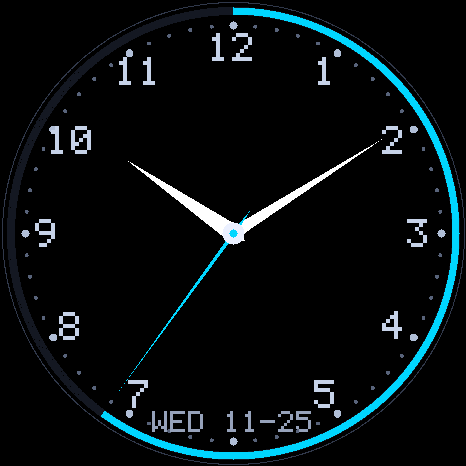
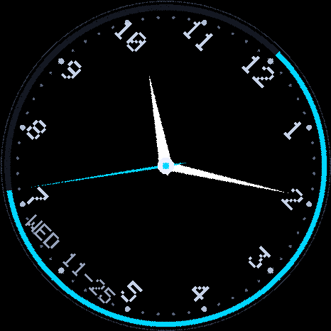

# Orbis

Waveshare **ESP32-S3-Touch-AMOLED-1.75**（466×466 CO5300 QSPI 圆屏）上的 Arduino / PlatformIO 工程。
当前进度：**v0.1 模拟时钟** —— 联网 NTP 校时，圆屏表盘每秒走一次，无整屏刷新（不闪）。

## 硬件

| 项目 | 参数 |
|---|---|
| 主控 | ESP32-S3R8，16MB Flash + 8MB OPI PSRAM |
| 屏幕 | CO5300 QSPI AMOLED，466×466，控制器 480×480（列偏移 6） |
| 触摸 | CST9217（I2C 0x5A，SDA 15 / SCL 14 / INT 11 / RST 40）|
| 其他 | AXP2101 PMIC、QMI8658 IMU、PCF85063 RTC、ES7210 双麦、ES8311 功放、TF 卡 |

屏幕引脚（见 `include/board_pins.h`）：
`CS 12 / SCLK 38 / D0-D3 4-7 / RST 39`，TE 引脚 GPIO13（本程序暂未用到）。

## 目录

```
platformio.ini        # 平台 / Flash / PSRAM / 依赖
include/board_pins.h  # 官方引脚定义
include/config.h      # WiFi、时区、NTP、亮度（唯一需要你改的文件）
src/main.cpp          # 启动、WiFi、NTP、主循环
src/clock_face.h/.cpp # 表盘绘制（几何全部在这里）
```

## 用法

1. 改 `include/config.h` 里的 `WIFI_SSID` / `WIFI_PASSWORD`（也可以新建 `include/secrets.h` 放这两个宏，避免误提交）。
2. 编译：`pio run`
3. 烧录：`pio run -t upload`（默认 `upload_speed = 921600`，失败可降到 460800）
4. 看日志：`pio device monitor`

串口正常输出：

```
[Orbis] round clock boot
[LCD] CO5300 ready 466x466
[MEM] PSRAM total 8189 KB, free 8189 KB
[LCD] canvas ready (PSRAM framebuffer)
[TIME] fallback = Wed Nov 25 23:05:44 2026
[WiFi] connected, IP = 192.168.x.x
[NTP] time synced
[PERF] frame = 49108 us          ← 每 30 秒一次，单帧渲染+推送耗时
```

## 表盘说明



- 结构（圆心 233,233）：外圈 r=231 → 秒进度环 219–226 → 60 个刻度点 r=208（每 5 分钟放大）→ 1–12 小时数字 r=186（size 4，24×32 点阵，数字 6 的位置留给日期）。
- 指针：时针 130px / 分针 178px / 秒针 200px（带 30px 尾巴），根部 11px 轴心。
- 底部（6 点位置）显示 `WED 11-25`（星期 + 月-日）。
- **颜色即状态**：秒针与秒环为**青色**= 已 NTP 校时；**琥珀色**= 没连上网，当前用的是编译时间。
- 渲染方式：**PSRAM 离屏画布（466×466×2 = 434KB）+ 每秒整帧重绘 + 一次 flush**。
  - 为什么不用「擦旧指针再画新指针」：那样指针必须短于所有静态元素（否则擦除会擦掉刻度/数字），指针只能做到半径的 40%，实机上看着「缩在中间」。
  - 整帧推送避免了中间态闪烁；实测一帧约 **49ms**（含 434KB QSPI 写入），1Hz 完全够用。
  - PSRAM 分配失败时自动退回直绘模式（会轻微闪），日志会打印 `canvas alloc FAILED`。

## 整屏旋转

`include/config.h` 里的 `CLOCK_ROTATE_DEG`（度，顺时针为正）可让整个画面旋转任意角度，**当前默认 0（关闭）**。

- 屏幕控制器的 `MADCTL` 只能整 90° 转（`setRotation(0~3)`），45° 这类角度只能在像素层做：
  画布画完后，对每个目标像素反算源坐标（`R(-θ)`，Q16.16 定点递减），最近邻取样到第二块 PSRAM 缓冲，再整帧推屏。
- 旋转围绕屏幕中心，表盘本身是个圆（内容都在 r≈231 以内），所以转任意角度都不会被裁掉。
- 取样是最近邻，45° 下细线（1px 外圈、2px 秒环）会有轻微锯齿；数字是 4 倍放大的点阵，转后仍然清晰。
- 设 `CLOCK_ROTATE_DEG 0` 即回到不旋转的直推路径（省一块 434KB 缓冲和一个像素循环）。



## 已知取舍 / 下一步

- 没 WiFi 时用编译时间起步，会走但不准。**下一步接板载 PCF85063 RTC**（I2C，掉电由 AXP2101 备份供电），断网也能守住时间。
- 触摸（CST9217）还没接：`lib_deps` 加 `lewisxhe/SensorLib` 即可做「点一下切换表盘」。
- 亮度固定 170；AMOLED 长时间常亮建议后续按环境/时间调光，或接 AXP2101 读电池。

## 工具链备注（踩过的坑）

- 平台用 `espressif32@6.8.0`（Arduino core 2.0.17），本机已有完整缓存，`pio run` 约 3 分钟首编、之后增量很快。
- **Arduino_GFX 必须锁 1.6.0**：1.6.1 起 `Arduino_ESP32SPI.h` 开始 include `esp32-hal-periman.h`，那是 Arduino core 3.x 才有的头文件，在 2.0.17 上必然报 `No such file or directory`。
- 若想用官方验证的 Arduino core 3.3.10 一系，把 `platform` 换成 pioarduino 分支（`.../releases/download/55.03.313/platform-espressif32.zip`），`lib_deps` 改回 `^1.6.9`。
- 当前产物：Flash 785 KB / 6.5 MB（12%），RAM 44 KB（13.8%）。

