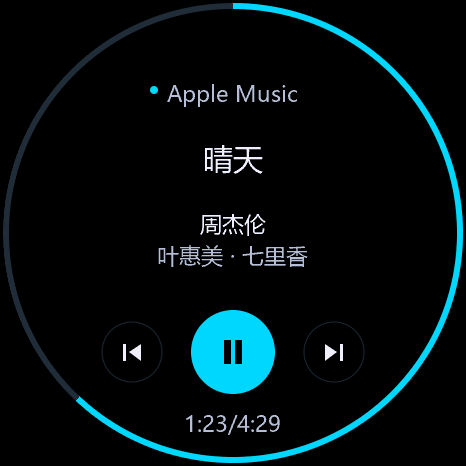

# Orbis

Waveshare **ESP32-S3-Touch-AMOLED-1.75**（466×466 CO5300 QSPI 圆屏）上的 Arduino / PlatformIO 工程。
当前进度：**v0.2 媒体遥控** —— BLE 走 Apple Media Service（AMS），显示 iPhone 正在播放的歌名/歌手/专辑/进度，
点屏幕控制上一首 / 播放暂停 / 下一首，PWR 键亮灭屏。旧的模拟表盘代码仍在仓库里但 `main.cpp` 已不引用。

## 硬件

| 项目 | 参数 |
|---|---|
| 主控 | ESP32-S3R8，16MB Flash + 8MB OPI PSRAM |
| 屏幕 | CO5300 QSPI AMOLED，466×466，控制器 480×480（列偏移 6） |
| 触摸 | CST9217（I2C 0x5A，SDA 15 / SCL 14 / INT 11 / RST 40）|
| 其他 | AXP2101 PMIC、QMI8658 IMU、PCF85063 RTC、ES7210 双麦、ES8311 功放、TF 卡 |

屏幕引脚（见 `include/board_pins.h`）：
`CS 12 / SCLK 38 / D0-D3 4-7 / RST 39`，TE 引脚 GPIO13（本程序暂未用到）。

## 目录

```
platformio.ini          # 平台 / Flash / PSRAM / 依赖
include/board_pins.h    # 官方引脚定义
include/config.h        # WiFi、时区、NTP、亮度、BLE 设备名、触摸校准
src/main.cpp            # 启动、显示/触摸/PMIC 初始化、屏幕开关、主循环
src/media_face.h/.cpp   # 媒体页绘制（布局常量、圆环、按钮、抗锯齿几何都在这里）
src/ams_client.h/.cpp   # BLE + AMS 协议（配对、Remote Command、播放信息解析）
src/cjk_font.h/.cpp     # 2bpp 灰阶点阵字体渲染 + RGB565 alpha 混合
src/font_title_30.cpp   # 30px 标题字体（10711 字形，2bpp，约 2.2MB 位图）
src/font_body_22.cpp    # 22px 正文字体（10711 字形，2bpp，约 1.2MB 位图）
src/font_num_52.cpp     # 52px 配对码数字（0-9 + 空格，2bpp，约 3KB 位图）
src/clock_face.h/.cpp   # 旧表盘（main.cpp 未引用，仅保留几何代码与预览文档）
tools/gen_font.py       # 字体生成脚本（FreeType 灰阶 → 2bpp 打包成 .cpp）
tools/preview_face.py   # 不开硬件、离线渲染媒体页预览图（核对布局/抗锯齿）
docs/                   # 预览图与巡检资料
```

## 用法

1. 一般只需改 `include/config.h`：`BLE_DEVICE_NAME`（iPhone 蓝牙列表里显示的名字）、
   `CLOCK_BRIGHTNESS`、触摸校准三项（`TOUCH_SWAP_XY` / `TOUCH_MIRROR_X` / `TOUCH_MIRROR_Y`）。
   `WIFI_*` / NTP 是旧表盘用到的，媒体页不联网。
2. 编译：`pio run`
3. 烧录：`pio run -t upload`（默认 `upload_speed = 921600`，失败可降到 460800）
4. 看日志：`pio device monitor`

使用流程：开机后屏幕显示「等待 iPhone 配对」，在 iPhone 的「设置 → 蓝牙」里选 `Orbis`；
若弹出配对码，屏幕会用 52px 数字显示（`在 iPhone 上输入此配对码`），配对完成后显示当前播放，
点屏幕底部三个圆钮控制上一首 / 播放暂停 / 下一首，PWR 键亮灭屏。

串口正常输出（媒体页版本）：

```
[Orbis] media remote boot
[LCD] CO5300 ready 466x466
[LCD] canvas ready (PSRAM framebuffer)
[I2C] found: 0x34 0x51 0x5A ...
[TOUCH] CST9217 ready, ...
[PMU] AXP2101 online, IC type=0x4A
```

## 媒体页（当前主界面）



> 预览图由 `tools/preview_face.py` 按设备同一套算法（2bpp 解码 + 1/16 覆盖率混合 + RGB565 帧缓冲）渲染，
> 用于在没有硬件时核对布局与抗锯齿效果。

### 布局（圆心 233,233，常量都在 `src/media_face.cpp` 顶部）

| 内容 | 位置 | 字体 |
|---|---|---|
| 进度环 | r=224–230（6px 带宽，0° 在 12 点、顺时针） | — |
| 状态行（连接状态 / 播放器名） | y=78，左侧带 4px 状态圆点 | FONT_BODY 22px |
| 歌名（最多两行，超出用 …） | y=126 / 162（单行时 138） | FONT_TITLE 30px |
| 歌手 / 专辑（超宽自动截断） | y=208 / 240 | FONT_BODY 22px |
| 三个圆形按钮 | y=352，x=132 / 233 / 334，r=30 / 42 / 30 | — |
| 已播/总时长 | y=408 | FONT_BODY 22px |
| 配对码 | y=168（墨迹 184–225） | FONT_NUM 52px |

重绘策略：内容变化、或播放中每 250ms（暂停时 1000ms）整帧重绘一次，画在 PSRAM 的
`Arduino_Canvas` 上再 `flush()`，所以不会闪。息屏时不 tick，点亮前先补一帧。

### 渲染管线（重要）

**为什么要自己写抗锯齿**：Arduino_GFX 的 `drawCircle` / `fillCircle` / `fillTriangle` 都是 Bresenham
硬边，自带字体只有 ASCII、`setTextSize(n)` 是整数倍放大的方块字；在 466px 的 AMOLED 上锯齿非常明显。

1. **文字 = 2bpp 灰阶点阵 + 逐像素 alpha 混合**
   - `tools/gen_font.py` 用 FreeType（`PIL.ImageFont` + 微软雅黑，缺字回退 Yu Gothic / MS Gothic）
     渲染灰阶，量化成 **4 级覆盖度**（0/1/2/3），每像素 2 bit、**4 像素/字节、MSB 在左**、行按字节对齐；
     字形是「紧贴墨迹」的裁剪图 + 相对行顶的偏移（`xoff/yoff`）+ 前进宽度 `adv`。
   - 运行时在 `cjkFind()` 二分查找（`glyphs` 按码位升序），`drawGlyph()` 解码 2bpp 后按覆盖度混合：
     `COVERAGE = {0, 5, 11, 16}`（1/16 单位），`blend565()` 用 `(src&0xF81F)*cov + (dst&0xF81F)*inv >> 4`
     一次算完 R/B，再单独算 G，5/6/5 字段之间有足够空位不会进位。
   - **为什么不用 4bpp**：4bpp 位图会是 1-bit 的 4 倍（约 7MB），固件涨到 ~8.4MB，
     超出 `default_16MB.csv` 的 6.4MB app 分区；2bpp（3.5MB 位图，固件约 4.9MB）刚好够。
     真要 4bpp 就得换单 app 分区表并放弃 OTA。
   - 绘制目标用 `CjkSurface`（canvas 的 RGB565 framebuffer + w/h，可选的 `gfx` 退化路径），
     因为 alpha 混合必须直接读写像素，走不了 Arduino_GFX 的 API。`_surf.fb` 只在
     **canvas rotation == 0** 时有效（帧缓冲才是连续 RGB565），`MediaFace::begin()` 里做了判断。

2. **几何 = 覆盖率抗锯齿**（`src/media_face.cpp`，全部用同一个 `cjkBlendPixel()` 混合）
   - `coverage(d)`：把「到边缘的距离」映射成 0–16 的 1/16 覆盖率，`d>=0.5` 直接覆盖、`d<=-0.5` 跳过。
   - `fillCircleAA` / `strokeCircleAA`：圆形按半径距离算覆盖率；细环用 `width=1.0`。
   - `fillTriangleAA`：三条有向边的距离取最小值（`edgeDist`），对角线自然获得抗锯齿。
   - `drawRingSegmentAA` + `ringSpan`：**按行先算环带 x 区间**（外圈 `xo`、内圈 `xi`，
     `xi==0` 时整行只画一次避免中心像素重复混合），只遍历环带内约 8.6k 像素，不是整圆 bbox 21 万像素；
     进度弧用 `atan2f` 判断角度落在 `[a0, a1]`（0° 在 12 点、顺时针），端面是硬切。
   - 帧成本：整帧填充 + 环 ~8.6k px + 圆形/三角形 ~25k px + 文字 ~6k px，250ms 一帧余量充足。

### 改字体 / 改字号

```bash
pip install pillow fonttools numpy
python tools/gen_font.py          # 重新生成 src/font_*.cpp（约 19MB 源码，编译会慢一些）
```

- 字号、字重、字符集都改脚本里的 `jobs` / `build_charset()`；改完要同步改 `media_face.cpp`
  顶部的布局常量（`ARTIST_Y` / `ALBUM_Y` / `TIME_Y` 等按 ascent 变化微调）。
- `FONT_*` 的 `lineHeight/ascent` 由脚本按 `getmetrics()` 自动写入；`ascent` 也被
  `drawHeader()` 用来算状态圆点的垂直居中。
- 旧版 1-bit 的 `src/font_body_20.cpp` 已删除，别再引用。

### 不开硬件验证版面

`tools/preview_face.py` 会解析 `src/font_*.cpp` 的 2bpp 数据，并按 `media_face.cpp` 同一套
覆盖率抗锯齿 / RGB565 混合算法渲染 PNG，改完字体或布局常量先跑一次，比烧板子快得多：

```bash
python tools/preview_face.py                    # 输出到 .screenshots/
python tools/preview_face.py --out docs         # 输出到 docs/（README 用的预览图就是这样来的）
python tools/preview_face.py --title 想你的夜 --artist 周杰伦 --progress 0.3
```

产出的 `media_face_aa_playing.png` / `_pairing.png` / `_idle.png` 对应播放中、配对、空闲三个状态。
脚本里的布局常量和 `media_face.cpp` 是两份拷贝，改布局时两边都要同步（否则预览会骗人）。

## AMS（Apple Media Service）要点

代码在 `src/ams_client.h/.cpp`，和 Moddable / MusicStation 的做法一致：

- **角色是「外设 + GATT Client」两头**：ESP32 先作 BLE 外设广播，并在广播数据里塞
  128-bit **Service Solicitation**（`ESP_BLE_AD_TYPE_128SOL_SRV_UUID` + AMS UUID），iPhone 才会
  把它识别成媒体遥控器并**主动发起连接和配对**；加密完成后，ESP32 再以 GATT Client 身份在
  同一条物理链路上 `esp_ble_gattc_open`（对已有 ACL 只建虚拟连接）去发现 iPhone 的 AMS 服务。
- UUID：Service `89D3502B-0F36-433A-8EF4-C502AD55F8DC`，
  Entity Update `2F7CABCE-808D-411F-9A0C-BB92BA96C102`，
  Remote Command `9B3C81D8-57B1-4A8A-B8DF-0E56F7CA51C2`。
- 配对参数：`ESP_LE_AUTH_REQ_SC_MITM_BOND` + `ESP_IO_CAP_OUT`（显示配对码，`FONT_NUM` 就是显示它），
  密钥 16 字节，绑定信息存 NVS，重连不需要重新配对。
- 通知格式：`[EntityID][AttributeID][Flags][UTF-8 Value…]`
  - Entity：0=Player / 1=Queue / 2=Track
  - Player 属性：0=Name / 1=PlaybackInfo（`state,rate,elapsed` 逗号分隔）/ 2=Volume（0–1 浮点，代码里换成 0–100）
  - Track 属性：0=Artist / 1=Album / 2=Title / 3=Duration
- 控制命令走 Remote Command 的写特征值：0=Play / 1=Pause / 2=Toggle / 3=Next / 4=Prev。
- **进度条不靠 iPhone 每秒推送**：收到 PlaybackInfo 时记下 `elapsed` 和本地毫秒时刻，
  UI 用 `AmsClient::elapsedNow()` 按 `rate` 外推；`generation` 每次内容变化 +1，`tick()` 靠它判断要不要重绘。
- 断连后自动回到广播状态（日志 `[AMS] disconnected, resume advertising`），等待下次连接。

## 旧表盘（`src/clock_face.cpp`，当前未接线）


- 结构（圆心 233,233）：外圈 r=231 → 秒进度环 219–226 → 60 个刻度点 r=208（每 5 分钟放大）→ 1–12 小时数字 r=186（size 4，24×32 点阵，数字 6 的位置留给日期）。
- 指针：时针 130px / 分针 178px / 秒针 200px（带 30px 尾巴），根部 11px 轴心。
- 底部（6 点位置）显示 `WED 11-25`（星期 + 月-日）。
- **颜色即状态**：秒针与秒环为**青色**= 已 NTP 校时；**琥珀色**= 没连上网，当前用的是编译时间。
- 渲染方式：**PSRAM 离屏画布（466×466×2 = 434KB）+ 每秒整帧重绘 + 一次 flush**。
  - 为什么不用「擦旧指针再画新指针」：那样指针必须短于所有静态元素（否则擦除会擦掉刻度/数字），指针只能做到半径的 40%，实机上看着「缩在中间」。
  - 整帧推送避免了中间态闪烁；实测一帧约 **49ms**（含 434KB QSPI 写入），1Hz 完全够用。
  - PSRAM 分配失败时自动退回直绘模式（会轻微闪），日志会打印 `canvas alloc FAILED`。

## 整屏旋转（仅旧表盘用到）

`include/config.h` 里的 `CLOCK_ROTATE_DEG`（度，顺时针为正）可让整个画面旋转任意角度，**当前默认 0（关闭）**，
媒体页不使用这个开关（`MediaFace` 始终 rotation 0，抗锯齿混合直接依赖连续帧缓冲）。

- 屏幕控制器的 `MADCTL` 只能整 90° 转（`setRotation(0~3)`），45° 这类角度只能在像素层做：
  画布画完后，对每个目标像素反算源坐标（`R(-θ)`，Q16.16 定点递减），最近邻取样到第二块 PSRAM 缓冲，再整帧推屏。
- 旋转围绕屏幕中心，表盘本身是个圆（内容都在 r≈231 以内），所以转任意角度都不会被裁掉。
- 取样是最近邻，45° 下细线（1px 外圈、2px 秒环）会有轻微锯齿；数字是 4 倍放大的点阵，转后仍然清晰。
- 设 `CLOCK_ROTATE_DEG 0` 即回到不旋转的直推路径（省一块 434KB 缓冲和一个像素循环）。


## 已知取舍 / 下一步

- Flash 预算吃紧：字体位图已占 3.5MB / 6.4MB app 分区（固件约 4.9MB）。再往上堆内容前，
  先考虑换单 app 分区表（`board_build.partitions`）或缩减 `gen_font.py` 的字符集。
- 亮度固定 170，呼吸感/对比度还没调；面板支持 `gfx->setContrast(CO5300_LowContrast~HighContrast)`
  （WCE 寄存器，提升对比度，深色背景上文字更利），需要时在 `initDisplay()` 里加一行。
- 息屏只关亮度（`setBrightness(0)`），没有进 sleep；后续可接 AXP2101 降功耗 + 抬腕/触摸唤醒。
- 旧表盘（`clock_face.cpp`）没有接抗锯齿，也没有接入 `main.cpp`；如果以后要切表盘，
  直接复用 `media_face.cpp` 里的 AA 几何函数 + `CjkSurface`。

## 工具链备注（踩过的坑）

- 平台用 `espressif32@6.8.0`（Arduino core 2.0.17），本机已有完整缓存；带字体源文件的首次全编会
  明显变慢（`font_title_30.cpp` 约 12MB、`font_body_22.cpp` 约 7MB），增量编译很快。
- **Arduino_GFX 必须锁 1.6.0**：1.6.1 起 `Arduino_ESP32SPI.h` 开始 include `esp32-hal-periman.h`，那是 Arduino core 3.x 才有的头文件，在 2.0.17 上必然报 `No such file or directory`。
- 若想用官方验证的 Arduino core 3.3.10 一系，把 `platform` 换成 pioarduino 分支（`.../releases/download/55.03.313/platform-espressif32.zip`），`lib_deps` 改回 `^1.6.9`。
- **core 2.0.17 没有 `MIN` / `MAX` 宏**（`Arduino.h` 里写明为避免和 C++ 冲突不定义 `min/max`），
  需要时用 `media_face.cpp` 里的 `imin()/imax()`；`RAD_TO_DEG` / `DEG_TO_RAD` 是有的。
- `Arduino_Canvas` 的帧缓冲是 **RGB565**，`getFramebuffer()` 拿到的指针只在 rotation 0 时可当作
  连续的 `w*h` 数组直接写；canvas 的 `flush()` 用 `draw16bitRGBBitmap` 推屏，字节序由驱动处理。
- 当前产物：Flash 约 **4.9MB / 6.4MB（app 分区）**，其中 2bpp 字体位图 3.53MB
  （标题 2.33MB + 正文 1.25MB + 配对码 3KB）+ 字形索引表约 0.3MB；PSRAM 里额外占 434KB 帧缓冲。


